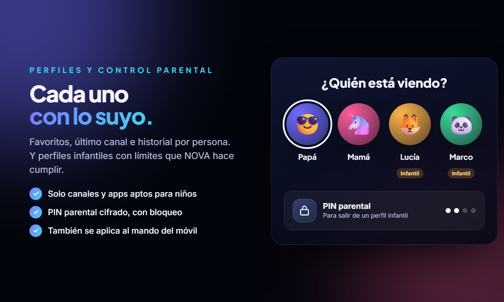
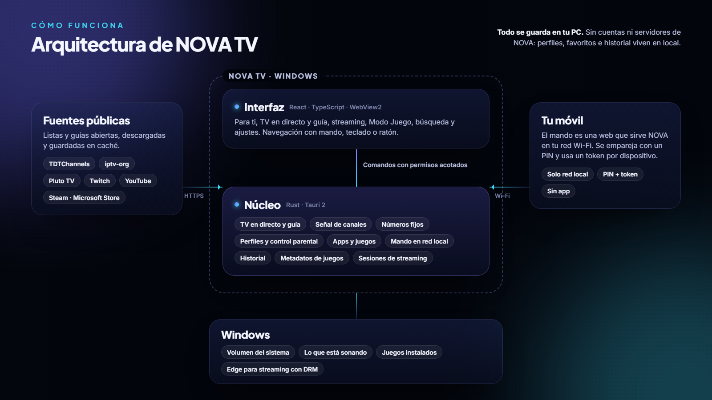

<div align="center">

<picture>
  <source media="(prefers-color-scheme: dark)" srcset="docs/assets/logo-light.svg" />
  <source media="(prefers-color-scheme: light)" srcset="docs/assets/logo-dark.svg" />
  
</picture>

### Tu PC, como una Smart TV.

TV en directo con guía, tus apps de streaming, tus juegos en modo consola y el mando en el móvil.


[**Descargar**](../../releases/latest) · [Funciones](#funciones) · [Controles](#controles) · [Cómo funciona](#cómo-funciona) · [Desarrollo](#desarrollo)

</div>

<br />

<p align="center">
  
</p>

## Qué es NOVA TV

NOVA TV convierte un PC con Windows en una Smart TV. Se enciende como una tele, con su animación y su sonido, directamente en tu último canal. Desde ahí lo tienes todo a un botón: más de 8.000 canales en directo con guía de programación, tus servicios de streaming, tus juegos en una interfaz de consola y tu móvil como mando a distancia.

Está pensado para el sofá: se maneja entero con un mando de consola, el teclado o el móvil.

## Funciones

<table>
  <tr>
    <td width="50%"></td>
    <td width="50%"></td>
  </tr>
  <tr>
    <td valign="top">

**TV en directo.** TDT española, canales gratuitos de Pluto TV, directos de Twitch y miles de canales públicos de todo el mundo. Todo en una guía por horas al estilo de las Smart TV, organizada en pestañas (Para ti, España, Noticias, Deportes, Cine y series, Infantil, Mundo…).

</td>
    <td valign="top">

**Mando en el móvil.** Escaneas el código QR de la tele y tu móvil es el mando: cruceta o modo táctil, canales, volumen, teclado, guía y "enviar a la tele" para vídeos de YouTube. Es una web servida en tu red local, sin nada que instalar.

</td>
  </tr>
  <tr>
    <td width="50%"></td>
    <td width="50%"></td>
  </tr>
  <tr>
    <td valign="top">

**Modo Juego (NOVA PLAY).** Encuentra los juegos instalados en tus tiendas y launchers y los muestra como una consola, con portadas, tráileres de fondo y tiempo jugado. Al cerrar el juego, vuelves a NOVA.

</td>
    <td valign="top">

**Perfiles y control parental.** Cada persona tiene sus favoritos, su último canal y su historial. Los perfiles infantiles solo ven canales y apps aptos, y salir de ellos pide un PIN parental.

</td>
  </tr>
</table>

### Y además

| | |
|---|---|
| 📺 **Señal comprobada** | Revisa los canales en segundo plano y oculta los caídos o bloqueados. |
| 🔢 **Números fijos** | Cada canal conserva su número aunque cambien las listas. |
| 🛟 **Canales que no se cortan** | Aprende qué canales van lentos y les da unos segundos de margen ("en diferido"). Además, arranca en la calidad que aguanta tu conexión. |
| 🖼️ **TV en miniatura** | Sigue viendo la tele en una esquina mientras navegas. |
| 💬 **Subtítulos** | Una sola pista, en español cuando el canal la emite (tecla <kbd>C</kbd>). |
| ▶️ **YouTube en modo tele** | La interfaz de TV de YouTube dentro de NOVA, con "Seguir viendo". |
| 🎬 **Tus apps de streaming** | Se abren a pantalla completa en Microsoft Edge, que es compatible con DRM. |
| 🔎 **Búsqueda global** | Canales, apps, juegos, vídeos y archivos del PC en un solo sitio. |
| 🎵 **Ahora suena** | Lo que se reproduce en Windows (Spotify, el navegador…), con controles. |
| ✨ **Arranque de tele** | Animación y sonido de inicio sintetizado, mientras sintoniza de verdad. |

## Descarga

1. Descarga el instalador desde [**Releases**](../../releases/latest).
2. Ábrelo y sigue los pasos. NOVA TV usa WebView2, que ya viene en Windows 10 y 11.
3. Para el mando: en NOVA ve a **Ajustes → Mando del móvil** y escanea el código QR con tu móvil, conectado al mismo Wi-Fi.

NOVA no se añade al inicio de Windows salvo que tú lo actives en **Ajustes → Inicio y energía**.

## Controles

| Acción | Teclado | Mando de consola |
|---|---|---|
| Moverse | Flechas | Cruceta / stick |
| Seleccionar | <kbd>Enter</kbd> | <kbd>A</kbd> |
| Volver | <kbd>Esc</kbd> / <kbd>Retroceso</kbd> | <kbd>B</kbd> |
| Volver a NOVA desde cualquier app | <kbd>Inicio</kbd> | Botón Xbox, o <kbd>Start</kbd> + <kbd>Select</kbd> |

**En la TV en directo:**

| Acción | Teclado | Mando de consola |
|---|---|---|
| Canal siguiente / anterior | <kbd>↑</kbd> <kbd>↓</kbd> | Cruceta |
| Guía de canales | <kbd>←</kbd> / <kbd>Enter</kbd> / <kbd>G</kbd> | <kbd>Y</kbd> |
| Información del programa | <kbd>→</kbd> | |
| Menú de TV | <kbd>M</kbd> | <kbd>View</kbd> |
| Favorito | <kbd>F</kbd> | <kbd>X</kbd> |
| Subtítulos | <kbd>C</kbd> | |
| Ir a un número | <kbd>0</kbd>–<kbd>9</kbd> | |
| Miniatura | <kbd>Esc</kbd> | <kbd>B</kbd> |

## Cómo funciona

<p align="center">
  
</p>

- **Interfaz en React** dentro de WebView2 y **núcleo en Rust** con Tauri 2. La interfaz solo puede llamar a los comandos que tiene permitidos, nunca ejecutar programas o comandos arbitrarios.
- **Las reglas importantes se aplican en Rust**, no en la pantalla. Por ejemplo, un perfil infantil ni siquiera recibe los canales o apps no permitidos, tampoco a través del mando del móvil.
- **El mando del móvil** solo funciona dentro de tu red local: se empareja con un PIN, cada móvil tiene su propio token y tras varios PIN fallidos se bloquea un rato.
- **Privacidad:** todo se guarda en tu PC, sin cuentas ni servidores de NOVA. El PIN parental se guarda cifrado (hash con sal), nunca en texto.

## Desarrollo

**Requisitos:** Windows 10/11, [Node.js](https://nodejs.org) 22 o superior, [Rust](https://rustup.rs) estable (edición 2024) y los [requisitos de Tauri para Windows](https://tauri.app/start/prerequisites/) (Microsoft C++ Build Tools y WebView2).

```bash
npm install
```

```bash
npm run tauri dev
```

Instalador (NSIS), que se genera en `src-tauri/target/release/bundle/nsis/`:

```bash
npm run tauri build
```

Tests de Rust (los que necesitan internet están marcados como `ignored`):

```bash
cd src-tauri && cargo test --lib
```

<details>
<summary><b>Estructura del proyecto</b></summary>

```
src/                      Interfaz (React + TypeScript)
  app/                    Estado global: perfiles, sonido de inicio, mando…
  components/             Pantallas compartidas (inicio, selector de perfil, PIN…)
  features/livetv/        TV en directo: reproductor, guía, catálogo, margen
  features/gaming/        Modo Juego (NOVA PLAY)
src-tauri/src/            Núcleo (Rust)
  livetv.rs               Canales, guía y números fijos
  livetv_health.rs        Comprobación de señal
  pluto.rs · twitch.rs    Fuentes de canales
  profiles.rs             Perfiles y control parental
  remote/                 Servidor del mando del móvil
src-tauri/remote/         La web del mando del móvil
docs/assets/              Logos, banner e imágenes de este README
marketing/                Piezas para redes sociales
```

</details>

## Recursos de marca

En `docs/assets/` tienes los logos en SVG (`logo-light.svg` para fondos oscuros, `logo-dark.svg` para fondos claros y `mark.svg` como icono), el banner y la imagen para compartir el repositorio (`social-preview.png`, que se sube en *Settings → Social preview* de GitHub).

Las imágenes se generan a partir de HTML. Para volver a exportarlas tras un cambio:

```bash
powershell -ExecutionPolicy Bypass -File docs/assets/src/render.ps1
```

## Fuentes y créditos

Los canales vienen de listas públicas: [TDTChannels](https://www.tdtchannels.com) (emisiones oficiales españolas y guía), [iptv-org](https://github.com/iptv-org/iptv) (canales públicos de todo el mundo), Pluto TV y Twitch. Los metadatos de juegos vienen de las tiendas públicas de Steam y Microsoft Store. NOVA TV no aloja ni redistribuye ningún contenido: reproduce las emisiones desde sus fuentes, con sus propios reproductores cuando así lo requieren.

> Twitch, Pluto TV, YouTube, Steam, Microsoft Store y el resto de marcas citadas pertenecen a sus respectivos propietarios. NOVA TV es un proyecto independiente y no está afiliado a ninguno de ellos.

## Licencia

Pendiente de definir.
